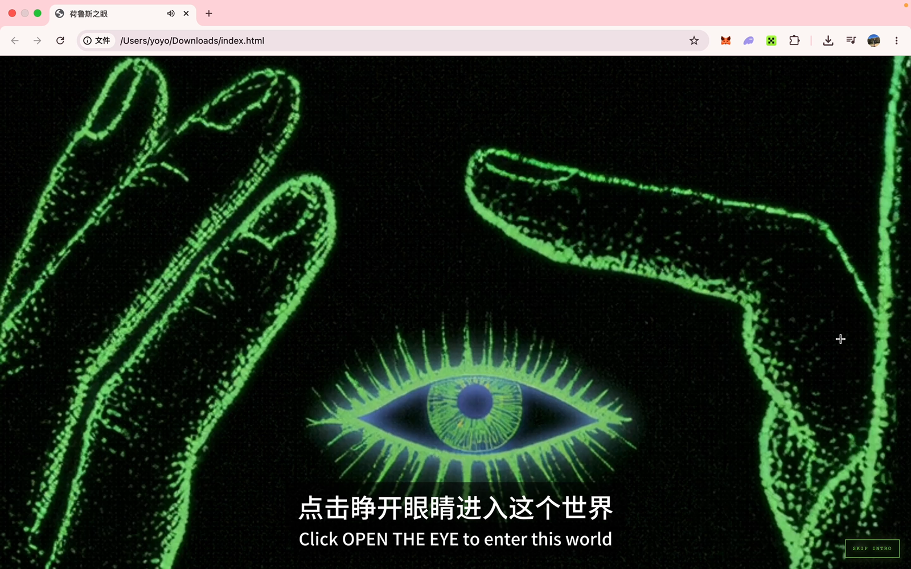

# 荷鲁斯之眼 / Eye of Horus

一个以手绘图形为种子、实时生成迷幻轨迹的浏览器数字交互作品。

[在线体验](https://lindawow.github.io/eye-of-horus/)



## 项目概念

《荷鲁斯之眼》把用户画下的简单线条转译为不断生长、衰减和重组的光流。眼睛不是装饰性的外框，而是整个交互的空间结构：生成画布被限制在眼仁区域内，轨迹像视觉信号一样从瞳孔中持续释放。

作品以黑色、荧光绿和冷紫为主色，结合手绘颗粒、老式屏幕噪点与 WebGL 反馈效果，形成介于数字仪式、生成艺术和视听装置之间的体验。

## 交互方式

1. 点击 `OPEN THE EYE` 进入作品，也可以跳过开场。
2. 点击顶部的手绘图标，打开 `Signal canvas`。
3. 画下任意线条，图形会立即成为动态场的发射源。
4. 点击参数图标，调节对称、流动、拖影、辉光和发射强度。
5. 点击声音图标控制音频；点击暂停按钮冻结或恢复动态。

## 核心特性

- 手绘种子实时进入生成系统
- 2-14 轴可调万花筒对称
- 基于反馈纹理的持续流动与拖影
- 多套动态色彩映射
- Bloom 辉光与颗粒化视觉处理
- 动态画布严格限制在眼仁形状内
- 响应式全屏构图，宽高比例不足时以同色深色背景填充
- 开场影像、视觉资源与运行代码全部内嵌，打开页面即可体验

## 技术实现

项目使用原生 HTML、CSS、JavaScript 和 WebGL 构建，不依赖框架或第三方运行时。

- WebGL 双缓冲反馈负责轨迹的累积、衰减和流场运动
- Canvas 2D 负责用户手绘输入
- GLSL 负责对称映射、色彩生成、辉光和最终合成
- CSS mask 将生成画面限制在手绘眼仁轮廓内
- 单文件交付方式保证作品可离线打开，也便于展览现场部署

## 本地运行

直接用浏览器打开 `index.html` 即可。为获得更稳定的媒体与 WebGL 行为，也可以在项目目录启动任意静态文件服务器。

```bash
python3 -m http.server 8000
```

然后访问 `http://localhost:8000`。

## 项目结构

```text
.
├── index.html                  # 完整交互作品
├── assets/preview.png          # 项目预览图
├── .github/workflows/pages.yml # GitHub Pages 自动发布
└── README.md                   # 项目说明
```

## 版本说明

仓库以源文件夹中修改时间最新的 `index.html` 为正式版本。旧版 HTML、网页保存缓存和超过 GitHub 单文件限制的原始录屏未纳入发布内容。

---

**Eye of Horus** is a browser-based generative artwork that transforms hand-drawn marks into a living field of symmetrical light, motion, persistence and decay.
